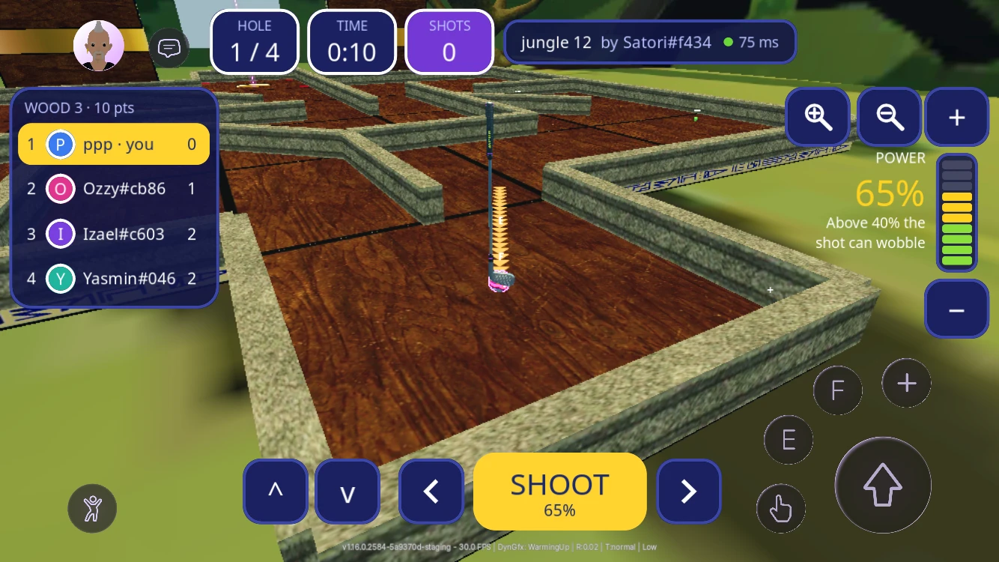
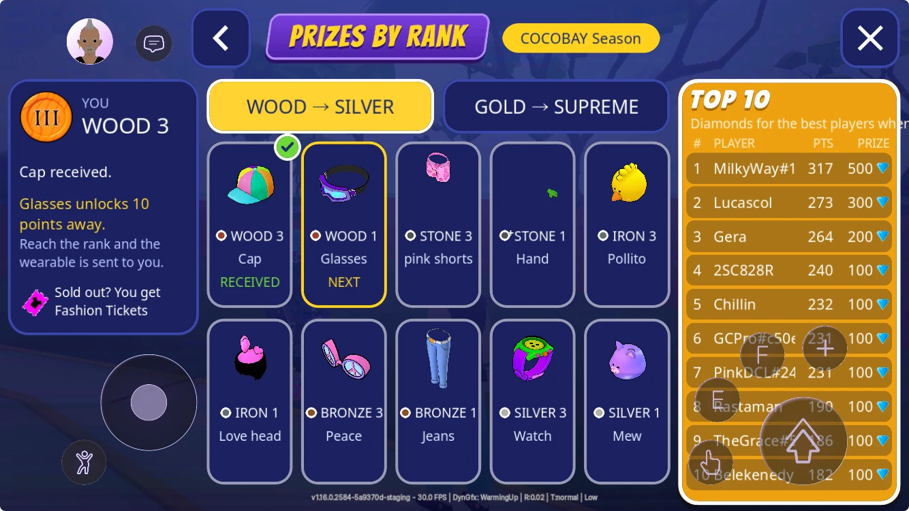

# OhMyGolf

A minigolf game for Decentraland: a new fork of **Golfcraft**, our minigolf game live in Decentraland since 2020. You play against other players' recorded runs and climb the ranks to win the season wearables; players build their own maps and organize their own tournaments.

- **Play it now (the deployed test scene):** https://decentraland.org/places/place/47,-45 (Genesis City, desktop and the Decentraland mobile app)
- **Game Design Document:** [design/gdd.md](design/gdd.md), with a 12-page visual version in [design/gdd.pdf](design/gdd.pdf) (Decentraland Creator Success application)

| Ranked hole on a phone | Season prizes by rank |
|---|---|
|  |  |

## What you can do today

- **Ranked runs:** 4 maps picked for your rank, against 3 recorded players, any time, with nobody to wait for. Rank points move you up the rank ladder; rank milestones send you the season's 20 wearables.
- **Ranked with friends:** 2 to 4 players on the same maps at once, seeing each other's balls.
- **Tutorial missions** with the clubhouse scientist, a golf club workshop, daily missions and a prizes board.
- Everything is reached from a 2D menu, built for phones first.

## The plan

- **V0 (this application):** the game as live today, tested with the community in a public event and polished from it, plus a step-by-step controls tutorial on the first hole.
- **v1 (four weeks):** community tournaments in the game menu, in the two formats Golfcraft had: **async** (open between a start and an end date, each player plays when they can) and **live** (everyone plays the same maps at the same time). Created, listed and played from the menu instead of in-world panels and the website.
- **v2:** the in-world map editor and the map-building contests that need it.

Details in the GDD, section 9.

## Repository layout

- `scene/` — the SDK7 scene (client): lobby, menus, courses, physics, shot controls
- `server/` — the Colyseus game server: ranked, party, mission and tournament rooms
- `web/` — the REST API and the golfcraftgame.com website (courses, tournaments, stats)
- `common/` — code shared by the scene and the servers (course definitions, physics config, constants)
- `studio/` — a second client on The Sandbox Studio, in progress
- `design/` — the GDD and its screenshots

## Run it locally

Needs Node 16 for the backend, podman (MySQL) and the Decentraland Desktop Client.

```bash
bash scripts/dev-up.sh        # MySQL, web API (2569), game server (2567), tunnel, preview
```

```bash
cd scene && npx sdk-commands start
```

The second command prints a `decentraland://` link that opens the local scene in the Desktop Client. The backend reads its credentials (PlayFab, database) from the `.env` files described in `deploy/README.md`; none are committed. The NFT bridge (`onchain-queue`) lives in a separate repository and is not needed to play locally.
